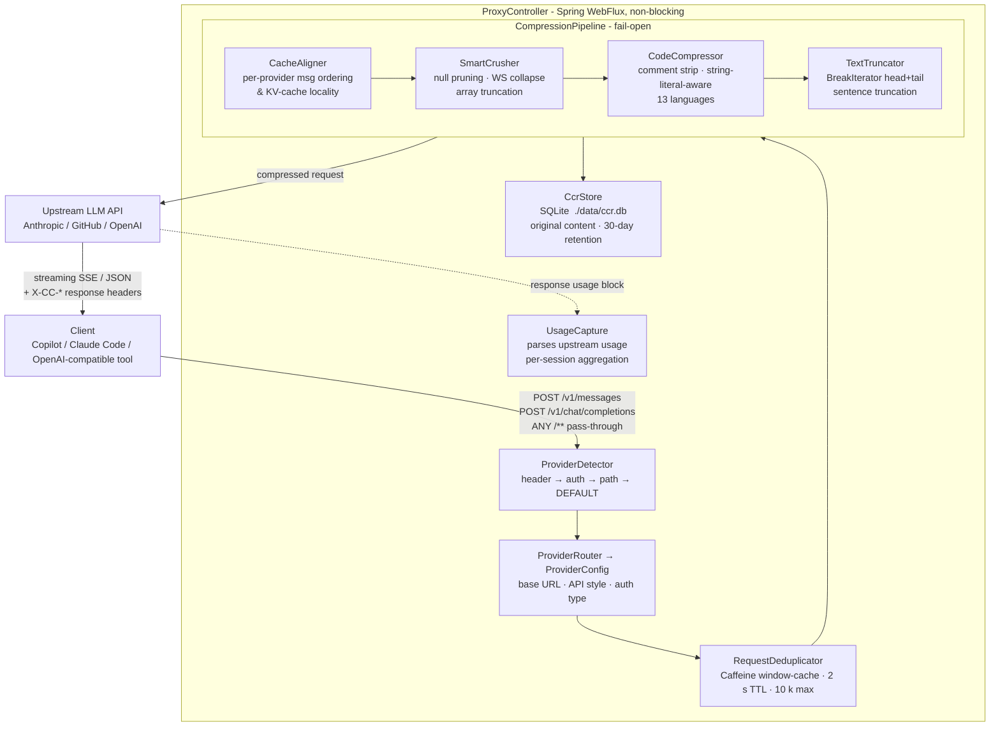

# ContextCompresso

> A VS Code extension that cuts your AI coding tool token costs - install it, point Copilot or Claude Code at it, done.

[](https://openjdk.org/)
[](https://code.visualstudio.com/)
[](./src/test)
[](LICENSE)

ContextCompresso is a VS Code extension for teams whose AI coding tools (GitHub Copilot, Claude Code) burn through token/credit budgets faster than expected. It runs a small local proxy for you, sits it between your tools and their LLM APIs, and shows you exactly where your tokens are going while it quietly strips out the low-signal content that was never worth paying for.

No cloud service, no telemetry leaving your machine, no changes to how you use Copilot or Claude Code day-to-day beyond a one-time config change the extension makes for you.

---

## Table of Contents

- [What It Does](#what-it-does)
- [Install](#install)
- [Using It](#using-it)
- [Code Search (VatStash)](#code-search-vatstash)
- [Extension Settings](#extension-settings)
- [Requirements](#requirements)
- [FAQ](#faq)
- [Building From Source](#building-from-source)
- [Reference: How The Proxy Works](#reference-how-the-proxy-works)
- [Contributing / Local Development](#contributing--local-development)
- [Testing](#testing)
- [Design Decisions Worth Noting](#design-decisions-worth-noting)

---

## What It Does

- **Runs a local proxy for you.** No terminal, no `java -jar`. The extension starts it when VS Code opens and stops it when VS Code closes.
- **Shows live cost signal in the status bar**: cache-hit percentage and effective token usage, updated every few seconds, with a trend arrow so a runaway session gets caught early instead of at the end of the day.
- **Gives you a dashboard** (click the status bar item) with cost drivers, an hourly usage trend, a per-model breakdown, and how much the compression pipeline is actually saving.
- **Compresses requests before they leave your machine**: strips redundant whitespace, dead JSON fields, code comments, and oversized tool output, then forwards the smaller request upstream and streams the response back unchanged. Typically invisible - the model never sees anything different.
- **Warns you when caching breaks.** Anthropic and OpenAI both bill cached tokens at a steep discount, but caching only works if your prompt prefix matches byte-for-byte between turns. If something breaks that (a client bug, an edited message), ContextCompresso flags it instead of leaving you to wonder why costs suddenly jumped.
- **Configures Copilot/Claude Code for you** with one click, instead of you hand-editing `settings.json` or shell profiles.
- **Searches your code locally (VatStash).** Copilot and Claude Code can ask the proxy for a few small snippets, with file paths and line ranges, instead of opening whole files. The index lives on your machine. See [Code Search (VatStash)](#code-search-vatstash).

---

## Install

You'll be given a `.vsix` file (built from this repo - see [Building From Source](#building-from-source) if you need to produce one yourself). No Marketplace account or public listing involved.

**From the command line:**

```bash
code --install-extension contextcompresso-0.1.0.vsix
```

**From VS Code:**

1. Open the Extensions view (`Cmd/Ctrl+Shift+X`)
2. Click the `...` menu at the top → **Install from VSIX...**
3. Select the `.vsix` file

Reload VS Code if prompted. That's the entire install - the extension bundles the proxy jar itself, so you don't need Maven, and you don't need Node or Python on your machine either; VS Code runs the extension's JavaScript using its own built-in runtime.

**The only real requirement:** Java 17 or newer on your PATH (or set via `JAVA_HOME`, or pointed to explicitly in settings - see [Extension Settings](#extension-settings)). That's what the bundled proxy runs on.

---

## Using It

Once installed, ContextCompresso starts automatically and you'll see a status bar item appear at the bottom right:

```
✓ 94% cached · 106k eff
```

- The **check/warning/flame icon** reflects your cache hit rate at a glance (good / degraded / poor).
- **`94% cached`** - percentage of input tokens served from cache this session. This is the number that predicts whether your next request is cheap or expensive.
- **`106k eff`** - effective input tokens, weighted by what cache reads/writes actually cost vs. full-price input. This is the number that maps to your credit/usage bar.
- Click it (or run **ContextCompresso: Show Usage Dashboard** from the Command Palette) to open the full dashboard.

### Point your tools at it

Run these from the Command Palette (`Cmd/Ctrl+Shift+P`):

| Command | What it does |
|---|---|
| **ContextCompresso: Point GitHub Copilot at Proxy** | Sets `github.copilot.advanced.debug.overrideProxyUrl` to the local proxy |
| **ContextCompresso: Point Claude Code at Proxy** | Sets `claudeCode.environmentVariables` (`ANTHROPIC_BASE_URL`) so the Claude Code VS Code extension routes through the proxy |
| **ContextCompresso: Show Usage Dashboard** | Opens the dashboard webview |
| **ContextCompresso: Restart Proxy** | Restarts the bundled proxy process |
| **ContextCompresso: Open Proxy Logs** | Opens the proxy's log output |

The extension also prompts you to run one of these automatically the first time the proxy starts, so you shouldn't need to hunt for them in the Command Palette on a fresh install.

Run the one for whichever tool you use and you're done - your API keys and auth headers are forwarded upstream unchanged, so nothing else about how you use the tool changes. Takes effect on the next request; no VS Code restart needed. If you run the Claude Code **CLI** outside VS Code (not the VS Code extension), that setting doesn't reach it - export `ANTHROPIC_BASE_URL` in your shell instead (the command offers to copy this for you).

---

## Code Search (VatStash)

VatStash is a local code search that ships inside the proxy and the extension. It indexes the folders you have open, and when an agent asks a question about your code it returns a handful of snippets with file paths and line ranges. The goal is for the agent to open fewer whole files. Nothing is sent to a cloud service, and there is no model download.

Search uses BM25 keyword ranking (Lucene) with identifier-aware tokens, so a query for `user` finds `getUserById`. It works best with identifiers and short keyword queries such as `payment retry backoff`, and less well with long natural-language questions. Copilot has its own `#codebase` and Claude Code can already grep, so VatStash is an addition, not a replacement. Whether it lowers your real token use is something to measure, and [`docs/PLAN-v3-vatstash.md`](docs/PLAN-v3-vatstash.md) describes how.

### GitHub Copilot

- **Agent mode.** Open the tools picker in Copilot Chat and make sure **VatStash: Search Workspace Code** is ticked. Copilot can then call it on its own, or you can write `#vatstash` in a prompt to point it at the tool.
- **`@vatstash`.** Type `@vatstash how is the retry policy configured` to search and have the chat model answer from the snippets. Type `@vatstash /search retry policy` to see the matching snippets without asking a model.

The tool needs VS Code 1.95 or newer, and `@vatstash` needs 1.90 or newer. On older versions the extension still works and these two entry points are simply absent. The **ContextCompresso: VatStash Search Code Index** command works on any supported version.

### Claude Code

Claude Code reaches VatStash through MCP. Run **ContextCompresso: VatStash Copy Claude Code MCP Command**, paste it into a terminal, and Claude Code gains a `search_code` tool. The command looks like this:

```bash
claude mcp add --transport http vatstash http://localhost:<port>/mcp
```

If port 8137 is taken, the proxy picks another port, so the URL can go stale after a restart. If `search_code` stops working, copy the command again and re-run it. The tool takes the project root from its `root` argument, so one registration serves every folder you have open.

### Status bar, commands and dashboard

A second status bar item shows the index state: `VS: indexing 42%`, `VS: updating`, `VS: 1.2k files` when ready, or `VS: index error`. Click it for a menu. It is hidden when VatStash is off, when no folder is open, or while the proxy is not running. The tooltip shows per-folder status and today's search calls and tokens.

| Command | What it does |
|---|---|
| **ContextCompresso: VatStash Search Code Index** | Asks for a query, lists matches, and opens the one you pick at its line range |
| **ContextCompresso: VatStash Reindex Workspace** | Checks every file against the index and updates what changed |
| **ContextCompresso: VatStash Rebuild Index** | Drops the index and rebuilds it from scratch (asks first) |
| **ContextCompresso: VatStash Clear Index** | Deletes the index for the open folders (asks first). The folders stay unindexed until you run Reindex |
| **ContextCompresso: VatStash Export Metrics** | Saves search metrics as CSV or Markdown for 1, 7, 30 or 90 days |
| **ContextCompresso: VatStash Copy Claude Code MCP Command** | Copies the `claude mcp add` command above |
| **ContextCompresso: VatStash Show Menu** | Opens the status bar menu |

The dashboard has a "Code search (VatStash)" section with index state per folder, searches today, tokens returned, the full-file estimate, the estimated reduction and median latency.

### How it keeps up with your edits

The extension watches your files and sends the proxy only the paths that changed. The proxy reads the files itself, so file contents never travel over the extension channel. It also checks the whole tree against the index when a folder is registered and about every 15 minutes while you search, so edits made while VS Code was closed (a `git pull`, a branch switch) get picked up. Search never waits for indexing. While the index is still building, results come back marked as possibly incomplete.

Files are skipped if they match your `.gitignore` or a `.vatstashignore` file (same syntax), the `contextcompresso.vatstash.excludeGlobs` setting, or the built-in list (`node_modules`, `target`, `build`, `dist`, `.git` and similar). Binary files, lockfiles, minified files and files over 512 KB are also skipped.

### What the numbers mean

The dashboard and the metrics export report what VatStash can observe: how many searches ran, how many tokens the returned text holds, and how long each search took. The full-file figure and the reduction percentage are estimates. They assume an agent would have read each matched file whole, and agents often read only line ranges, so the real saving can be smaller. Token counts use a GPT-family tokenizer, so they are approximate for Claude. Treat the real billed tokens in the usage dashboard as the source of truth.

### Privacy

The index holds copies of your source text, stored under VS Code's global storage for the extension (`<globalStorage>/data/vatstash/`), outside your repository. Anyone who can read your user profile can read it. **ContextCompresso: VatStash Clear Index** deletes it. Search events are logged locally with the query length and a hash, not the query text, unless you set `contextcompresso.vatstash.store-query-text` on the proxy. The endpoints accept connections from this machine only.

### Turning it off

Set `contextcompresso.vatstash.enabled` to `false` in VS Code settings to stop the extension from registering folders and to hide the status bar item. To turn the proxy side off as well, start it with `contextcompresso.vatstash.enabled=false`, after which every `/vatstash` and `/mcp` request returns 503. To stop one client from using it, untick the tool in the Copilot tools picker or run `claude mcp remove vatstash`.

---

## Extension Settings

| Setting | Default | Description |
|---|---|---|
| `contextcompresso.jarPath` | *(empty)* | Path to `contextcompresso.jar`. Leave empty to use the jar bundled with the extension. |
| `contextcompresso.port` | `8137` | Port the local proxy listens on. |
| `contextcompresso.autoStart` | `true` | Start the proxy automatically when VS Code opens. |
| `contextcompresso.javaPath` | *(empty)* | Path to a Java 17+ executable. Leave empty to auto-detect (`JAVA_HOME`, then `PATH`). |
| `contextcompresso.vatstash.enabled` | `true` | Index open folders and offer code search to Copilot and Claude Code. |
| `contextcompresso.vatstash.excludeGlobs` | `[]` | Extra glob patterns to leave out of the index, on top of `.gitignore` and `.vatstashignore`. |
| `contextcompresso.vatstash.maxFileSizeKb` | `512` | Files larger than this are not indexed. |
| `contextcompresso.vatstash.maxFiles` | `50000` | Most files indexed per folder. |
| `contextcompresso.vatstash.maxResults` | `8` | Snippets returned per search. |
| `contextcompresso.vatstash.maxResultTokens` | `4000` | Token budget for one search result. |
| `contextcompresso.vatstash.showStatusBar` | `true` | Show the VatStash index status bar item. |

---

## Requirements

- **Java 17+** - to run the bundled proxy. Nothing else to install.
- **VS Code 1.85+.** The VatStash Copilot tool needs 1.95+ and the `@vatstash` chat participant needs 1.90+. On 1.85 to 1.89 everything else still works.

You do **not** need Maven, Node.js, or Python to install or run the extension - those are only needed if you're building it from source (see below).

---

## FAQ

**Does this send my code anywhere?** No. The proxy runs entirely on your machine and only forwards requests to the same upstream (Anthropic/GitHub/OpenAI) your tool was already talking to. Nothing goes to a ContextCompresso server, because there isn't one.

**Will my API key be affected?** No. Auth headers pass through unchanged; the proxy never inspects or stores your key.

**Why is the cache-hit percentage low / red?** It means your prompt prefix changed between turns - often from editing an earlier message, or a client that doesn't resend history byte-for-byte. Cached tokens are ~10x cheaper than fresh ones, so a broken cache is usually the single biggest cost driver in a session. Check the dashboard's "cost drivers" section.

**Can I use this without the VS Code extension?** Yes - the extension is a convenience wrapper around a standalone Java proxy. See [Building From Source](#building-from-source) and [Reference: How The Proxy Works](#reference-how-the-proxy-works) if you want to run it directly, e.g. for a non-VS-Code editor.

**Where's the data stored?** Locally in a SQLite file the proxy manages on its own; nothing is synced anywhere.

---

## Building From Source

Needed only if you're producing the `.vsix` yourself rather than installing a pre-built one. This step does need Node.js (to compile the extension's TypeScript) and Maven (to build the proxy jar) - but only on the machine doing the build, never on a machine installing the result.

```bash
git clone <repo-url>
cd ContextCompresso/vscode-extension
npm install -g @vscode/vsce   # one-time
./build.sh
```

This builds `contextcompresso.jar` from the Maven project, copies it into `resources/` so it ships inside the extension, compiles the TypeScript, and packages `contextcompresso-0.1.0.vsix` in the same directory.

**Iterating on the extension itself:** open `vscode-extension/` in VS Code and press `F5` to launch an Extension Development Host with your changes loaded live - no `.vsix` packaging needed while you're actively working on it.

See [`vscode-extension/README.md`](vscode-extension/README.md) for the extension's internal source layout.

---

## Reference: How The Proxy Works

This section is for anyone extending the proxy, running it standalone outside VS Code, or just curious what's actually happening to their requests. None of it is necessary reading to use the extension.

### Architecture



Streaming SSE or JSON chunks are piped directly back to the client without buffering. Response headers (`X-CC-Original-Chars`, `X-CC-Compressed-Chars`, `X-CC-Ratio`, `X-CC-Request-Id`) are injected before the client sees the response. Any path other than `/v1/messages` and `/v1/chat/completions` is forwarded as a raw byte stream with no compression or storage - useful for keep-alive pings, token-count endpoints, etc.

### Feature list

| Feature | Details |
|---|---|
| Multi-provider routing | Detects Copilot vs. Claude vs. generic OpenAI-compatible from auth headers, path, and request shape |
| Provider override header | `X-CC-Provider: CLAUDE` / `COPILOT` / `DEFAULT` bypasses all heuristics |
| Four-stage compression pipeline | Cache alignment → structural cleanup → code comment stripping → sentence-boundary truncation |
| Tool-result compaction | Line-based head+tail truncation for oversized `tool_result` blocks specifically |
| Cache-prefix divergence detection | Flags when a session's cached prompt prefix changes between turns |
| Usage telemetry + stats API | Captures `usage` data from upstream responses and aggregates it per session/hour/model |
| Fail-open safety | Any exception anywhere in the pipeline falls back to forwarding the original, unmodified request |
| String-literal-aware comment stripping | Handles `//`, `/* */`, `#` across 13 languages without corrupting string literals |
| Compressed Content Registry (CCR) | Every original pre-compression message is stored in SQLite and retrievable, auto-purged after 30 days |
| Request deduplication | Caffeine window-cache short-circuits duplicate payloads within a 2-second window |
| SSE streaming passthrough | No buffering of streamed responses |
| Micrometer metrics | Counters/timers for requests, compression ratio, chars/tokens saved, upstream duration, dedup hits |

### Tech stack

| Layer | Technology | Notes |
|-------|-----------|-------|
| Language | Java 17 | Records, sealed types, text blocks |
| Framework | Spring Boot 3.2.5 + WebFlux | Fully reactive/non-blocking request path |
| HTTP Client | Spring WebClient (Reactor Netty) | Streaming-safe; no response body buffering |
| Database | SQLite via `xerial/sqlite-jdbc 3.45.3.0` | WAL mode + NORMAL sync; single-table append-mostly local store; no ORM overhead |
| JSON | Jackson `ObjectNode` pipeline | Operates on `JsonNode` trees - generic and resilient to unknown fields |
| Tokenizer | jtokkit `CL100K_BASE` | Exact GPT-family token counts for Copilot; calibrated char-ratio heuristic for Claude |
| Caching | Caffeine | Deduplication window cache, bounded to 10,000 entries |
| Metrics | Micrometer + Spring Actuator | Exposed at `/actuator/metrics` |
| Code search | Apache Lucene `lucene-core 9.11.1` | BM25 index per workspace, no vectors or native libraries |
| Java chunking | JavaParser `javaparser-core 3.26.2` | Splits `.java` files by class and method; other languages use a line-based chunker |

### Component reference

| Component | Role |
|---|---|
| `ProxyController` | Three endpoints: `/v1/messages` (Claude), `/v1/chat/completions` (Copilot/OpenAI), `/**` catch-all passthrough. 60s upstream timeout; fail-open |
| `ProviderDetector` | Detection priority: `X-CC-Provider` header → auth-header heuristics → path → DEFAULT |
| `ProviderRouter` | Maps detection result to a `ProviderConfig` record (base URL, API style, auth type, token budget, estimator) |
| `CompressionPipeline` | Orchestrates the four stages; fail-open wrapper; records Micrometer metrics |
| `CacheAligner` | Provider-aware message ordering for KV-cache/prompt-cache locality |
| `SmartCrusher` | Null/empty field pruning, whitespace collapsing, array head+tail truncation |
| `CodeCompressor` | String-literal-aware comment/blank-line stripping for 13 languages; aggressive mode strips imports |
| `TextTruncator` | `BreakIterator`-based head+tail sentence truncation for oversized text blocks |
| `ToolResultCompactor` | Line-based head+tail truncation for oversized `tool_result` blocks (tool output is naturally line-delimited, unlike prose) |
| `RequestDeduplicator` | Caffeine window-cache (2s TTL, max 10,000 entries) short-circuits SHA-256-matched duplicate requests |
| `CcrStore` | `JdbcTemplate`-backed SQLite repository; SHA-256 keyed entries; `INSERT OR REPLACE` semantics |
| `CcrController` | `GET /ccr/{id}` and `GET /ccr/request/{requestId}` - original content retrieval |
| `CcrPurgeScheduler` | Nightly purge of entries beyond retention window |
| `JtokkitEstimator` | Exact GPT token counts via jtokkit `CL100K_BASE` - used for Copilot |
| `AnthropicEstimator` | Calibrated heuristic (`chars/3.2` prose, `chars/2.5` code) - used for Claude |
| `UsageCapture` / `UsageExtractor` / `UsageStore` | Taps response bodies (including SSE) for `usage` data, parses it, persists per-session records |
| `SessionKeyResolver` | Derives a stable session key from `system` + the first message, so it survives conversation growth |
| `CachePrefixMonitor` | Compares the overlapping message range across turns to detect prompt-prefix divergence |
| `StatsService` / `StatsController` | Aggregates `UsageRecord`s into live/today/top-cost views, exposed at `/stats/*` |
| `VatStashController` | REST API under `/vatstash/*`: workspace registry, change notifications, search, metrics. Unknown paths under it return 404 instead of falling into the passthrough |
| `McpController` / `McpRequestHandler` | Minimal stateless MCP endpoint (`POST /mcp`, JSON-RPC 2.0) exposing one `search_code` tool to Claude Code |
| `LocalOnlyWebFilter` | Rejects `/vatstash/**` and `/mcp` requests that are not from loopback or carry a foreign `Origin` header |
| `WorkspaceIndexer` / `WorkspaceRegistry` | Background indexing thread, file scanner and ignore rules, one Lucene index per workspace |
| `CodeSearchService` / `Bm25Retriever` | Builds the query, ranks chunks, limits chunks per file, merges overlaps and applies the token budget |
| `VatStashMarker` | Result text starts with `[vatstash v1]`. `CompressionPipeline` and `SmartCrusher` leave text carrying it alone |
| `VatStashMetricsService` | Records each search in SQLite (asynchronously, fail-open) and builds the summary and export |

### Proxy configuration reference

All settings live in `src/main/resources/application.yml` under `contextcompresso.*`, overridable via `-Dcontextcompresso.some.property=value` or the equivalent environment variable.

| Property | Default | Description |
|---|---|---|
| `server.port` | `8137` | Port the proxy listens on |
| `contextcompresso.providers.copilot.base-url` | `https://api.githubcopilot.com` | Copilot upstream |
| `contextcompresso.providers.claude.base-url` | `https://api.anthropic.com` | Claude upstream |
| `contextcompresso.providers.default.base-url` | `https://api.openai.com` | Fallback for any OpenAI-compatible endpoint |
| `contextcompresso.compression.enabled` | `true` | Master switch for the pipeline |
| `contextcompresso.compression.min-compress-chars` | `200` | Requests smaller than this pass through untouched |
| `contextcompresso.compression.tool-result-compaction-enabled` | `true` | Head/tail line compaction of oversized `tool_result` blocks |
| `contextcompresso.compression.max-tool-result-chars` | `2000` | Threshold above which a `tool_result` block is compacted |
| `contextcompresso.ccr.enabled` | `true` | Store originals in SQLite for retrieval |
| `contextcompresso.ccr.db-path` | `./data/ccr.db` | SQLite database path |
| `contextcompresso.ccr.retention-days` | `30` | Originals older than this are purged nightly at 2am |
| `contextcompresso.usage.cache-read-weight` | `0.1` | Weight applied to `cache_read_input_tokens` when computing effective cost |
| `contextcompresso.usage.cache-write-weight` | `1.25` | Weight applied to `cache_creation_input_tokens` when computing effective cost |
| `contextcompresso.usage.retention-days` | `30` | Usage records older than this are purged nightly at 2:15am |
| `contextcompresso.vatstash.enabled` | `true` | Master switch. When `false`, every `/vatstash` and `/mcp` request returns 503 |
| `contextcompresso.vatstash.index-dir` | *(empty)* | Where indexes are stored. Empty means a `vatstash` folder next to the `ccr.db` file |
| `contextcompresso.vatstash.max-file-bytes` | `524288` | Files larger than this are skipped |
| `contextcompresso.vatstash.max-files-per-workspace` | `50000` | Most files indexed per workspace |
| `contextcompresso.vatstash.max-open-workspaces` | `20` | Most indexes held open at once |
| `contextcompresso.vatstash.min-chunk-lines` / `max-chunk-lines` / `overlap-lines` / `max-chunk-chars` | `15` / `120` / `10` / `6000` | Chunk size limits for non-Java files and long Java methods |
| `contextcompresso.vatstash.commit-interval-ms` | `10000` | How often index changes are committed to disk |
| `contextcompresso.vatstash.indexing-pause-ms` | `2` | Pause between files while indexing, to keep CPU use low |
| `contextcompresso.vatstash.reconcile-interval-minutes` | `15` | A search triggers a full check of the tree if the last one is older than this |
| `contextcompresso.vatstash.default-max-results` / `max-results-cap` | `8` / `30` | Default and upper limit for snippets per search |
| `contextcompresso.vatstash.default-max-tokens` / `max-tokens-cap` | `4000` / `16000` | Default and upper limit for the result token budget |
| `contextcompresso.vatstash.max-chunks-per-file` | `3` | Most snippets from one file in a single result |
| `contextcompresso.vatstash.metrics-retention-days` | `90` | Search events older than this are purged daily |
| `contextcompresso.vatstash.store-query-text` | `false` | Keep the query text in search events. Off by default, only length and a hash are kept |
| `contextcompresso.vatstash.mcp-enabled` | `true` | Serve `POST /mcp` |
| `contextcompresso.vatstash.mcp-auto-register` | `true` | Let the MCP tool register an unknown project root on first use |

See [`docs/PLAN-v1.md`](docs/PLAN-v1.md) for the original architecture reference, [`docs/PLAN-v2-dashboard.md`](docs/PLAN-v2-dashboard.md) for the usage-telemetry/dashboard design, and [`docs/PLAN-v3-vatstash.md`](docs/PLAN-v3-vatstash.md) for the code search design, API contract and pilot protocol.

### Running the proxy standalone (without the extension)

```bash
mvn clean package
java -jar target/contextcompresso.jar
curl http://localhost:8137/actuator/health   # {"status":"UP"}
```

Point a client at it the same way the extension's commands do:

```bash
export ANTHROPIC_BASE_URL=http://localhost:8137          # Claude Code
```
```json
{ "github.copilot.advanced": { "debug.overrideProxyUrl": "http://localhost:8137" } }
```

Every proxied response carries `X-CC-Original-Chars`, `X-CC-Compressed-Chars`, `X-CC-Ratio`, and `X-CC-Request-Id` headers; the latter retrieves the pre-compression original via `GET /ccr/request/{id}`. Usage aggregates are available at `/stats/live`, `/stats/session/{key}`, `/stats/today`, and `/stats/top-costs`.

The code search endpoints are open to this machine only:

| Endpoint | Purpose |
|---|---|
| `POST /vatstash/workspaces`, `GET /vatstash/workspaces` | Register a folder (idempotent) and list registered folders |
| `GET /vatstash/workspaces/{id}/status` | Index state, file and chunk counts, progress |
| `POST /vatstash/workspaces/{id}/changes` | Report changed and deleted absolute paths (up to 2000 per call) |
| `POST /vatstash/workspaces/{id}/reindex` | Reconcile, or rebuild with `{"full":true}` |
| `DELETE /vatstash/workspaces/{id}` | Unregister a folder and delete its index |
| `POST /vatstash/search` | Search by `workspaceIds` or `root`. Returns structured hits plus the exact `text` a model receives |
| `GET /vatstash/metrics/summary?days=7`, `GET /vatstash/metrics/export?days=30&format=csv` | Search metrics. The full-file token figure is an estimate |
| `POST /mcp` | MCP over HTTP (JSON-RPC 2.0), tool `search_code`. Other methods return 405 |

The request and response shapes are in [`docs/PLAN-v3-vatstash.md`](docs/PLAN-v3-vatstash.md). Custom Micrometer metrics (`cc.tokens.saved`, `cc.chars.saved`, `cc.compression.ratio`, `cc.dedup.hits`, `cc.cache.prefix.diverged`, etc.) are under `/actuator/metrics`.

---

## Contributing / Local Development

```bash
mvn spring-boot:run              # run without building a fat jar
mvn test                         # run the Java test suite
mvn test -Dtest=CodeCompressorTest   # a single test class
```

Create `src/main/resources/application-local.yml` (gitignored) for local overrides, then run with `--spring.profiles.active=local`. The project includes `spring-boot-configuration-processor`, so IntelliJ and VS Code (with Spring Boot Tools) auto-complete `contextcompresso.*` properties.

For the extension itself, see [Building From Source](#building-from-source) above.

---

## Testing

```bash
mvn test
```

170 tests across 34 classes covering provider detection, each compression stage in isolation (including tool-result compaction), token estimators, CCR storage, usage extraction/session-keying/cache-prefix detection, stats aggregation, and full end-to-end proxy behavior via `MockWebServer` for Copilot-, Claude-, and generic-style requests - including that upstream receives a smaller body, fail-open holds when compression or usage capture is skipped, and CCR entries are correctly written. The VatStash tests cover chunking, ignore rules, the analyzer, indexing and reconcile, search shaping, MCP, the local-only filter, metrics, and the compression passthrough for marked results.

---

## Design Decisions Worth Noting

**Fail-open as a hard constraint.** The entire compression pipeline is wrapped in a single try/catch. A compression bug silently falls back to forwarding the original body - a proxy that blocks calls is worse than a proxy that doesn't compress.

**Session keys hash only the system prompt and first message.** A stateless proxy has no session concept to draw on, so `SessionKeyResolver` derives one from `system` + `messages[0]` only, since later message indices aren't stable across turns (index 1 is empty on turn 1, but holds the assistant's reply by turn 2). `CachePrefixMonitor` faces the same problem and solves it the same way: it compares only the message range that overlaps between two consecutive requests, so ordinary conversation growth is never mistaken for a cache-prefix divergence.

**Tool-result compaction splits on lines, not sentences.** `TextTruncator`'s `BreakIterator`-based sentence splitting requires an uppercase letter after `". "` to register a boundary, which fails silently on tool output shaped like `"file.java:12: match. src/other.java:8: ..."` - a lowercase continuation collapses the whole block into one unsplittable "sentence." `ToolResultCompactor` sidesteps this by splitting on `\n` instead, which is both correct and simpler for content that's naturally line-delimited (grep dumps, stack traces, command output).

**SQLite with plain `JdbcTemplate`, no JPA.** The CCR is a single-table append-mostly local store; ORM overhead adds nothing here.

**`AnthropicEstimator` uses a content-aware char ratio.** Token estimation for Claude uses `chars/3.2` for prose and `chars/2.5` for code, switching based on a scan of the first 2,000 characters for structural tokens (`{`, `}`, `;`, `function`, `def `, etc.).

**BM25 before embeddings.** VatStash ranks with Lucene BM25 over identifier-aware tokens. A vector model would add about 85 MB of native libraries and a model download, with a different failure mode on every platform. The search sits behind a `Retriever` interface so dense retrieval can be added later without touching the indexer or the API.

**Search results skip compression.** Left alone, `ToolResultCompactor` would cut a 4000-token search result to 15 lines. Every VatStash result starts with `[vatstash v1]`, and `CompressionPipeline` and `SmartCrusher` skip text that carries it. The result is already limited by a token budget.

**A local-only filter in front of the new endpoints.** The proxy listens on all interfaces and forwards unknown paths upstream, which is wrong for an endpoint that returns source code. `LocalOnlyWebFilter` rejects non-loopback callers and foreign `Origin` headers, and the new controllers answer unknown paths themselves. The filter does not check the `Host` header yet, so a DNS rebinding attack could still reach the `GET` endpoints. That is on the roadmap in [`docs/PLAN-v3-vatstash.md`](docs/PLAN-v3-vatstash.md).

---

## License

[Apache 2.0](LICENSE)
