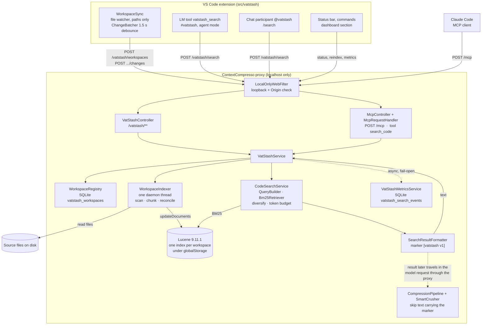

# ContextCompresso v3: VatStash Local Code Search

This plan supersedes [`VatStash-implementation-plan_1.md`](./VatStash-implementation-plan_1.md), which stays in the repo as the original idea. The sections below record what was built, why it differs from that first plan, and what is deferred. Where the two disagree, this document and the code win.

---

## Problem statement

The team's constraint is still a credit bar metered on tokens (see [`PLAN-v2-dashboard.md`](./PLAN-v2-dashboard.md)). v1 shrinks what the proxy forwards. v2 shows what a session costs. Neither reduces how much code an agent pulls into context in the first place.

Coding agents find code by opening whole files and running greps. Every file read lands in the conversation and is resent on each later turn, either as cache reads or as fresh input. A 900-line file read to find one 40-line method pays for 860 lines it did not need.

**Goal:** give Copilot and Claude Code a local code search tool that returns a few small snippets with file paths and line ranges, so the agent opens fewer whole files. Everything stays on the developer's machine, and the effect is measured instead of assumed.

**What VatStash is not.** Copilot already has `#codebase` and Claude Code already greps. VatStash does not claim to beat either on quality. Its distinct properties are that it is local only, returns snippets with line ranges under a token budget, serves Copilot and Claude Code from one index, and records its own usage. Whether it lowers real spend is an open question until the pilot below has run.

---

## Decisions and why

The original plan proposed a separate VS Code extension with ONNX embeddings, DJL, Lucene vector search and a leadership metric based on full-file token counts. Reading it against this repo changed several decisions.

### 1. A feature inside ContextCompresso, not a separate extension

The extension already finds Java 17+, spawns one shared JVM per machine (a pidfile in global storage lets other windows adopt it), passes `--contextcompresso.ccr.db-path=<globalStorage>/data/ccr.db`, and has SQLite, a status bar and a dashboard. A second extension would duplicate all of that and add a second JVM. VatStash is a package inside the proxy (`com.contextcompresso.vatstash`) and a folder inside the extension (`src/vatstash/`).

### 2. BM25 before embeddings

| Option | Cost |
|---|---|
| Lucene 9.11.1 BM25 | A few MB, one pure-Java jar (`lucene-core`), no native code |
| ONNX Runtime plus a MiniLM model | About 85 MB of native libraries for every platform, plus a 23 to 90 MB model, per-platform failure modes, not testable offline |

An identifier-aware analyzer (camelCase and snake_case splitting) with boosts on the symbol and path fields handles most of what coding agents ask, because agents write keyword queries when the tool description tells them to. Dense retrieval stays on the roadmap behind a single `Retriever` interface, so adding it later does not touch the indexer or the API. Lucene 10 needs Java 21, so the project pins Lucene 9.11.1. DJL is dropped. If dense vectors return, the plan is `onnxruntime` plus a WordPiece tokenizer directly.

BM25 is weaker on long natural-language questions. The mitigations are the keyword-style tool descriptions, the symbol and path boosts, and a "type" outline chunk per class. Treat this as a known weakness to measure, not a solved one.

### 3. JavaParser and a heuristic chunker, no tree-sitter

`.java` files go through JavaParser 3.26.2 (language level 21). A parse failure falls back to the heuristic chunker. Every other language uses a heuristic chunker that cuts at top-level boundaries, blank lines and Markdown headings, with size caps and overlap. Tree-sitter needs native libraries, so it is deferred. "Maven module boundaries" from the original plan became a `pathPrefix` filter on search, not a chunking unit.

### 4. One index per workspace root, who watches files

The proxy is shared across windows, so each root gets a `workspaceId`: the first 16 hex characters of the SHA-256 of its real path. The extension watches files with `createFileSystemWatcher` and sends paths only, never contents. The Java side reads from disk.

The Java side also runs a reconcile: walk the tree, compare size and mtime with the manifest, and rehash only when those differ. It runs on registration, on demand, when a search finds the last scan older than `reconcile-interval-minutes`, and from a one-minute maintenance tick for recently used workspaces. This catches edits made while VS Code was closed (a `git pull`, a branch switch) and serves Claude Code CLI users who have no VS Code. There is no Java `WatchService` yet.

Ignore rules run in Java so the HTTP path and the MCP path behave the same: built-in directories, then `.gitignore` files (root and nested), then `.vatstashignore`, then the user's `excludeGlobs`.

### 5. Staleness through Lucene, not a side table

Each file has one "file" manifest document (SHA-256, mtime, size, token count) plus its chunk documents, all sharing `file_key`. A file is replaced with one `updateDocuments(Term(file_key), docs)` call, so a reader sees the old version or the new one, never a mix. This is the "fall back to the previous version" behaviour the original plan asked for. The manifest lives in the same index as the chunks, so the two cannot drift apart.

Search never blocks on indexing. While an index is building or updating, search returns what it has with `freshness: "stale"`.

### 6. MCP for Claude Code, hand-rolled

Claude Code has no Language Model Tools API. It speaks MCP. VatStash ships a minimal MCP endpoint (`POST /mcp`, streamable HTTP in JSON-response mode, stateless) with one tool, `search_code`. It is about 300 lines of Jackson, because the official Java MCP SDK targets newer Spring than Boot 3.2.5 and the subset needed is small and easy to test. `GET` and `DELETE` on `/mcp` return 405.

### 7. Copilot through the LM tool API, with feature detection

The extension registers a language model tool (`vatstash_search`, referenced as `#vatstash`) and a chat participant (`@vatstash`). Language model tools need VS Code 1.95 and chat participants need 1.90. The README promises VS Code 1.85+, and compression users should not be locked out. So `engines` stays at `^1.85.0`, `@types/vscode` stays at `^1.85.0`, and the extension checks `typeof vscode.lm?.registerTool` and `typeof vscode.chat?.createChatParticipant` at runtime. Older hosts ignore the unknown contribution points and run as before. Bumping `engines` to `^1.95.0` later would remove the checks.

### 8. Security and passthrough fixes

Three findings from reading the existing proxy changed the design. None of them appear in the original plan.

1. **The proxy would destroy VatStash results.** `CompressionPipeline` compacts any `tool_result` above about 500 tokens down to 5 head lines and 10 tail lines, strips comments from text, and `SmartCrusher` collapses whitespace in strings. A 4000-token search result sent through the proxy would be gutted. Every VatStash result text starts with the marker `[vatstash v1]`. `VatStashMarker.isVatStashText` returns true when the marker appears in the first 200 characters, and the pipeline (tool-result compaction and text compression) and `SmartCrusher` skip any text that carries it. The result is already token-budgeted, so skipping is safe. Nothing else in the pipeline changed.
2. **Unmapped paths were forwarded to OpenAI.** `ProxyController` maps `/**` to the generic passthrough, so a mistyped `/vatstash/foo` or `GET /mcp` would have left the machine. `VatStashController` has its own `/vatstash/**` catch-all that returns a 404 JSON body, and `McpController` returns 405 for other methods on `/mcp` and 404 under `/mcp/**`.
3. **The proxy listens on every interface.** `server.address` is unset. An endpoint that indexes arbitrary paths and returns their source must not be reachable from the LAN or from a web page. `LocalOnlyWebFilter` guards `/vatstash/**` and `/mcp`. It rejects any non-loopback remote address and any `Origin` other than `vscode-webview://*`, `vscode-file://*`, and `http(s)://localhost`, `127.0.0.1` or `[::1]` with an optional port. A request with no `Origin` is allowed. Rejections return 403 `forbidden`. Root validation also refuses a relative path, a file, the filesystem root and the user's home directory.

Known limitation: the filter does not check the `Host` header. A DNS rebinding attack that points a hostile name at 127.0.0.1 makes later requests same-origin, and browsers normally omit `Origin` on same-origin `GET` requests. That leaves the `GET` endpoints (workspace list, status, metrics) reachable from a hostile page. `POST /vatstash/search` and `POST /mcp` carry an `Origin` in browsers, so they are covered. A Host-header allowlist closes the gap and is on the roadmap. Binding the whole proxy to 127.0.0.1 is a separate decision (it could break access from Docker or WSL) and has not been made.

### 9. Persistent registration

Registered workspaces are stored in SQLite (`vatstash_workspaces`), so a proxy restart or a window adopting the proxy does not lose them. The extension also re-registers every folder on each transition to running or adopted. Registration is idempotent.

### 10. Honest metrics

The original plan's headline was "tokens without VatStash = full files". That is a counterfactual, not a measurement. VatStash records what it can observe (tokens in the exact text returned, latency, call counts, zero-result rate) and labels the full-file figure an estimate everywhere it appears. The defensible number comes from the pilot protocol below, which compares real billed tokens. See [Metrics](#metrics-and-their-caveats).

---

## Architecture



Two things worth reading off the diagram. The extension never sends file contents, only paths. The result text reaches the model through the client, and when that client is routed through ContextCompresso the marker keeps the pipeline from compacting it.

---

## HTTP API contract

Base URL `http://localhost:<port>`. Bodies are JSON in UTF-8. All paths under `/vatstash` and `/mcp` are loopback only.

### Errors

The body is `{"error":"<code>","message":"<text>"}`, the same shape as the existing `deserialization_failed`.

| Code | Status | When |
|---|---|---|
| `invalid_request` | 400 | Malformed JSON, missing or wrongly typed field, empty query, query with no searchable terms, neither `workspaceIds` nor `root` on search, more than 2000 paths in `changes`, bad `format` on export |
| `invalid_root` | 400 | Not absolute, not an existing directory, the filesystem root, or exactly the user's home directory |
| `forbidden` | 403 | Non-loopback remote address or disallowed `Origin` |
| `workspace_not_found` | 404 | Unknown workspace ID, or a search `root` that is inside no registered root |
| `not_found` | 404 | Any other path under `/vatstash/`, or under `/mcp/` |
| `method_not_allowed` | 405 | `GET`, `DELETE` or any method other than `POST` on `/mcp`. Carries `Allow: POST` |
| `vatstash_disabled` | 503 | `contextcompresso.vatstash.enabled=false`, or `mcp-enabled=false` for `POST /mcp` |
| `vatstash_unavailable` | 503 | The index directory or an index could not be opened, or an unexpected failure |

### Index status

Embedded in several responses.

```json
{"workspaceId":"a1b2c3d4e5f60718","root":"/abs/root","state":"building|updating|ready|error",
 "freshness":"fresh|stale","filesIndexed":1234,"filesSkipped":17,"chunksIndexed":9876,
 "pendingFiles":0,"progress":{"done":400,"total":1234},"indexBytes":12345678,
 "lastFullScanAt":1763600000000,"lastUpdateAt":1763600100000,"truncated":false,"lastError":null}
```

- `building`: the first full scan has not finished.
- `updating`: queued change events, a rebuild, or a reconcile that has found something to replace or delete. A reconcile that only verifies an unchanged index does not flip the state.
- `ready` when idle. `freshness` is `fresh` only when `state` is `ready`.
- `error`: the index failed to open, or the last run failed and nothing is running.
- `truncated` is true when the `max-files-per-workspace` cap (or the per-workspace `maxFiles` setting) was hit.
- Timestamps are epoch milliseconds, 0 when the event has not happened.

### Endpoints

| Method and path | Request | Response |
|---|---|---|
| `POST /vatstash/workspaces` | `{"root":"/abs/root","settings":{"excludeGlobs":["**/generated/**"],"maxFileBytes":524288,"maxFiles":50000}}`. `settings` and its fields are optional. A `client` field is accepted and ignored. | 200 `{"workspaceId","root","status"}`. Idempotent. Starts a background reconcile. `root` in the response is the real path. |
| `GET /vatstash/workspaces` | none | 200 array of `{"workspaceId","root","status"}` |
| `GET /vatstash/workspaces/{id}/status` | none | 200 index status, or 404 |
| `POST /vatstash/workspaces/{id}/changes` | `{"changed":["/abs/a.java"],"deleted":["/abs/b.ts"]}`. Absolute paths, at most 2000 in total. | 202 `{"accepted":2,"ignored":1}`. Paths outside the root or matching ignore rules count as ignored. A deleted directory removes everything under that prefix. |
| `POST /vatstash/workspaces/{id}/reindex` | `{"full":false}`. `false` reconciles. `true` drops the index and rebuilds it. The body may be empty. | 202 index status |
| `DELETE /vatstash/workspaces/{id}` | none | 204. Unregisters the workspace, closes the index and deletes its directory. |
| `POST /vatstash/search` | see below | 200 search response |
| `GET /vatstash/metrics/summary?days=7` | none | 200 metrics summary. `days` is clamped to 1..90. |
| `GET /vatstash/metrics/export?days=30&format=csv` | none | 200 `text/csv` or `text/markdown`. `format` is `csv`, `md` or `markdown`. |
| `POST /mcp` | JSON-RPC 2.0 message, optional `?workspace=<id or path>` | 200 `application/json`, or 202 with no body for notifications |
| any other method on `/mcp` | none | 405 with `Allow: POST` |

### Search

Request:

```json
{"query":"payment retry backoff","workspaceIds":["a1b2c3d4e5f60718"],"root":null,
 "maxResults":8,"maxTokens":4000,"pathPrefix":"services/payment","languages":["java"],
 "client":"copilot-tool"}
```

- Either `workspaceIds` or `root` is required. `root` can be any path inside a registered root. The longest matching root wins.
- `maxResults` defaults to 8 and is clamped to 1..30. `maxTokens` defaults to 4000 and is clamped to 1..16000. These caps come from `max-results-cap` and `max-tokens-cap`. The extension and the MCP tool clamp `maxResults` to 20 themselves.
- `languages` accepts language ids and short forms such as `ts`, `py`, `kt`.
- `client` is a free label stored with the metrics event. Values in use are `copilot-tool`, `chat-participant`, `command`, `mcp` and `http` (the default).
- With several workspaces, scores come from a `MultiReader`, so they are comparable across them.

Response:

```json
{"searchId":"uuid","query":"payment retry backoff","tookMs":14,"freshness":"fresh",
 "results":[{"workspaceId":"a1b2c3d4e5f60718","path":"src/main/java/x/PaymentService.java",
   "absolutePath":"/abs/root/src/main/java/x/PaymentService.java","language":"java",
   "symbol":"PaymentService.retryCharge","kind":"method","startLine":120,"endLine":168,
   "score":7.53,"content":"...","tokens":410}],
 "totals":{"returnedTokens":2310,"sourceFileTokens":18650,"filesMatched":4,
   "chunksReturned":6,"omittedByBudget":3},
 "text":"[vatstash v1] 6 snippets from 4 files for: payment retry backoff\n..."}
```

Lines are 1-based and inclusive. `path` uses `/` separators and is relative to the workspace root. `kind` is one of `type`, `method`, `constructor`, `members`, `block`, `section`, `window` or `file`.

How results are shaped:

1. The retriever takes the top `maxResults * 4` chunks by BM25.
2. At most `max-chunks-per-file` (3) chunks per file survive, and overlapping line ranges in the same file are merged.
3. The remaining chunks are sorted by score and cut to `maxResults`.
4. A token budget is applied greedily in score order, counting each snippet's tokens plus 12 for its header. The first result is always returned. If it alone is over budget, its content is cut and ends with `… (truncated)`.
5. `text` is built from what remains, and `returnedTokens` is measured on `text`.

### Result text

`text` is exactly what the model receives.

```
[vatstash v1] 6 snippets from 4 files for: payment retry backoff
index: fresh · 1234 files · root /abs/root

--- src/main/java/x/PaymentService.java:120-168 · java · method PaymentService.retryCharge
<raw chunk content>

--- ...
(3 more matches omitted to stay within the 4000-token budget; narrow the query or set pathPrefix.)
```

- No Markdown fences, because code contains backticks.
- When the index is not ready, the second line begins `index: building` (or `updating`), then shows done and total files and says results may be incomplete.
- With zero results the text is `[vatstash v1] No matches for: <query>. Try identifiers (class/method/config names) or fall back to your normal search tools.` When the index is not ready, the same stale-index line is appended to that message so the caller knows an empty answer may be temporary.

### MCP

`POST /mcp` accepts one JSON-RPC 2.0 message per request. A JSON array (batch) gets -32600.

| Method | Behaviour |
|---|---|
| `initialize` | Returns the client's `protocolVersion` if it looks like `YYYY-MM-DD` and is at least `2025-03-26`, otherwise `2025-06-18`. Advertises the `tools` capability, server name `contextcompresso-vatstash`, and an `instructions` string. |
| `notifications/*` and any message without an `id` | 202, no body |
| `ping` | `{}` |
| `tools/list` | One tool, `search_code`, with arguments `query` (required), `root`, `pathPrefix`, `languages` and `maxResults` (1 to 20) |
| `tools/call` | `{"content":[{"type":"text","text":<result text>}],"isError":false}` |

Root resolution for `tools/call`: the `root` argument first, then the `?workspace=` query parameter (an ID or a path), then the single registered workspace if exactly one exists. An unknown `root` is registered on the spot when `mcp-auto-register` is on, and the first answer may be partial while it indexes. If the target is still ambiguous the tool returns `isError: true` with the list of registered roots. Search failures are `isError: true` text, never a transport error. Error codes: -32700 parse error, -32600 invalid request or batch, -32601 unknown method, -32602 invalid params or unknown tool, -32603 internal error.

---

## Index layout and Lucene document schema

### Location

```
<dirname(contextcompresso.ccr.db-path)>/vatstash/<workspaceId>/lucene/
```

Inside the extension that is `<VS Code global storage>/data/vatstash/<workspaceId>/lucene/`. Set `contextcompresso.vatstash.index-dir` to put it elsewhere. Registered roots and search events live in the same SQLite file as the rest of the proxy data, in two tables:

| Table | Columns |
|---|---|
| `vatstash_workspaces` | `workspace_id` (primary key), `root`, `settings_json`, `registered_at`, `last_seen_at` |
| `vatstash_search_events` | `id`, `workspace_ids`, `client`, `query_chars`, `query_hash`, `query_text` (null unless `store-query-text`), `results`, `files`, `returned_tokens`, `source_file_tokens`, `took_ms`, `freshness`, `created_at`, indexed on `created_at` |

Each index stores copies of source text, so it is roughly the size of the indexed source or somewhat more. This is an estimate and should be measured on a real monorepo. If an index is corrupt or from an incompatible Lucene version, the registry deletes it and builds it again.

### Analyzer

`CodeAnalyzer` is `CodeTokenizer`, then lower-casing, then a small English stop list (`the a an and or of to in on for is are how where what which does do with from by this that it be`). `CodeTokenizer` emits each identifier whole, then its sub-words at the same position: camelCase, PascalCase, snake_case and letter-to-digit boundaries. `getUserById` yields `getuserbyid`, `get`, `user`, `id`. `by` is a stop word, so it is dropped. A query for `user` finds `getUserById`, and a query for the full identifier still matches exactly. The same analyzer runs at index time and query time.

### Chunk document

| Field | Lucene type | Stored | Notes |
|---|---|---|---|
| `doc_type` | StringField | no | Always `chunk` |
| `file_key` | StringField | no | Path relative to the root, `/` separators |
| `path` | StringField | yes | Used for `pathPrefix` (PrefixQuery) |
| `path_text` | TextField | no | Searchable path words, boost 2 |
| `language` | StringField | yes | Used for the `languages` filter |
| `symbol` | TextField | yes | Qualified, for example `Outer.Inner.method`. Boost 3. Absent when unknown |
| `kind` | StoredField | yes | |
| `start_line`, `end_line` | StoredField (int) | yes | 1-based, inclusive |
| `content` | TextField | yes | Raw chunk text, boost 1 |
| `tokens` | StoredField (int) | yes | cl100k token count of `content` |

### File (manifest) document

| Field | Lucene type | Stored |
|---|---|---|
| `doc_type` | StringField | no (`file`) |
| `file_key` | StringField | yes |
| `manifest_key` | StringField | no |
| `sha256`, `mtime`, `size`, `file_tokens`, `chunk_count`, `skipped_reason`, `indexed_at` | StoredField | yes |

The index also keeps `lastFullScanAt` in the Lucene commit data. On open, the manifest is loaded from the file documents, so indexing resumes where it stopped.

### Chunking and scanning rules

- **Java:** JavaParser. A "type" chunk per class holds the declaration, fields and member signatures without bodies, as an outline. One chunk per method or constructor, including Javadoc and annotations. Runs of members shorter than 5 lines are grouped into a `members` chunk. A body longer than `max-chunk-lines` is split into `window` chunks with `overlap-lines` of overlap.
- **Other languages:** cut at top-level declarations (found by brace depth, or by column-0 declarations and decorators in indentation-based languages) and at Markdown headings, once a chunk has `min-chunk-lines`. A cut is forced at `max-chunk-lines` or `max-chunk-chars`, preferring a blank line, with overlap. Every line of a file is covered by some chunk.
- **Skipped:** built-in directories (`.git .hg .svn node_modules target build out dist .gradle .idea .vscode .next .nuxt coverage __pycache__ .venv venv .tox bin obj vendor .terraform`), anything matched by `.gitignore`, `.vatstashignore` or `excludeGlobs`, files over `max-file-bytes`, binary files (a NUL byte in the first 8 KB), symlinks, lockfiles, `*.min.js`, `*.min.css`, `*.map`, and `.json` files over 100 KB. Only recognised languages and file names are indexed (code, config, SQL, Markdown, HTML and CSS, plus Dockerfile, Makefile and Jenkinsfile).
- **Indexer:** one low-priority daemon thread named `vatstash-indexer` serves every workspace. It pauses `indexing-pause-ms` between files, refreshes the searcher every 50 files or one second, and commits every `commit-interval-ms`.

---

## Metrics and their caveats

Each search writes one row to `vatstash_search_events`, asynchronously and fail-open: a metrics failure never affects the search. The query text is not stored unless `store-query-text` is true. Only its length and SHA-256 are kept. Rows older than `metrics-retention-days` (90) are purged daily at 02:30.

| Metric | Definition |
|---|---|
| `calls` | Searches recorded in the window, from every client including the command palette |
| `byClient` | Calls per `client` label |
| `returnedTokens` | cl100k tokens of the exact `text` returned, summed |
| `sourceFileTokens` | Estimate. Full-file cl100k tokens of the distinct files the returned snippets came from, summed |
| `estimatedReductionRatio` | `1 - returnedTokens / sourceFileTokens`, or 0 when `sourceFileTokens` is 0. An estimate |
| `avgChunksPerCall` | Mean snippets per call |
| `p50LatencyMs`, `p95LatencyMs` | Nearest-rank percentiles of server-side search time |
| `zeroResultCalls` | Calls that returned no snippets |
| `byDay` | Calls and tokens per UTC day |

CSV export has the header `created_at_iso,client,workspace_ids,query_chars,results,files,returned_tokens,source_file_tokens,took_ms,freshness`, uses RFC 4180 quoting and CRLF line endings. The Markdown export is a summary table followed by the estimate note.

Caveats to carry into any report:

1. **`sourceFileTokens` is a counterfactual.** It assumes the agent would have read each matched file whole. Agents often read line ranges, so the baseline can overstate savings.
2. **The baseline is inflated when the client runs through ContextCompresso.** File-read tool results are already compacted by the proxy, so the "full file" an agent would actually have paid for is smaller than the manifest says.
3. **The token counts are cl100k.** They are exact for GPT-family models and approximate for Claude. The same estimator measures both sides of the ratio, so the ratio is consistent but the absolute counts are not Claude's billing numbers.
4. **The budget excludes the header.** The token budget counts snippet tokens plus 12 per snippet. The two header lines and the omitted-matches line are not budgeted, so `returnedTokens` can slightly exceed `maxTokens`.
5. **A search that finds the answer does not prove the agent stopped reading files.** A call count says nothing about displaced reads.
6. **The dashboard's "today" is the last 24 hours** (`days=1`), not a calendar day.

The headline number for leadership must come from the pilot below, not from this table.

---

## Pilot protocol

The question is whether VatStash lowers real billed tokens for the same work. The proxy already records those in `usage_records`.

**Setup**

1. Pick 10 to 20 realistic tasks from the team's backlog that need code navigation: "find where X is validated and add a case", "why does Y return null", "add a field through three layers". Write each as a fixed prompt. Use one repository at one commit and reset to that commit before every run.
2. Use one client and one model per pilot (for example Claude Code with a fixed model). Run Copilot as a second pilot, not mixed in.
3. Route the client through ContextCompresso for both arms, so `usage_records` captures every request.
4. Run each task twice in a fresh session, once with VatStash on and once off. Alternate which arm goes first, and start each run from a clean working tree.
5. Wait until the index status is `ready` before any "on" run. A cold index would bias against VatStash.

**Switching the arms**

| Client | VatStash on | VatStash off |
|---|---|---|
| Copilot agent mode | `vatstash_search` ticked in the tools picker | Untick it in the tools picker |
| Claude Code | `claude mcp add --transport http vatstash http://localhost:<port>/mcp` | `claude mcp remove vatstash` |

Setting `contextcompresso.vatstash.enabled` to `false` also turns the feature off in the extension, but removing the tool from the client is the clearer control. Leave the Copilot `@vatstash` participant unused in both arms.

**Collecting data**

Per-session attribution of tool calls is not built, so use time windows. Run one task at a time, with nothing else going through the proxy, and note a start and end timestamp for each run. Then sum `usage_records` inside each window:

```sql
SELECT SUM(input_tokens)       AS input,
       SUM(output_tokens)      AS output,
       SUM(cache_read_tokens)  AS cache_read,
       SUM(cache_write_tokens) AS cache_write,
       COUNT(*)                AS requests
FROM usage_records
WHERE created_at BETWEEN :start_ms AND :end_ms;
```

Also export `GET /vatstash/metrics/export?format=csv` for the same period to get call counts, zero-result rate and latency for the "on" runs.

**Analysis**

- Compare the four token fields separately, and also an effective figure using the proxy's weights (cache read 0.1, input 1, cache write 1.25, plus whatever output weight the team's credit bar uses).
- Report per-task paired differences, the median, and the range. With this few runs, do not report a single percentage without the spread.
- Record task success separately (did the change work, did it need re-prompting). Fewer tokens on a failed task is not a saving.
- Watch the "on" runs' call counts. If the agent rarely calls the tool, adoption is the problem, not retrieval quality.

**Pass and fail**

Decide before the run. A reasonable bar is a median effective-token reduction the team agrees is worth the setup, with no drop in task success. If the agent calls the tool but results are poor, that argues for the dense retrieval work below. If it does not call the tool, that argues for tool description changes or the code map idea.

---

## Deferred roadmap

The seams for these are in place. None is built.

| Item | Notes |
|---|---|
| Dense embeddings with RRF | A second `Retriever` behind the existing interface. Lucene `KnnFloatVectorField` for HNSW, `onnxruntime` plus a WordPiece tokenizer (no DJL), a MiniLM-class model downloaded on first use, merged with BM25 by reciprocal rank fusion (k = 60). Needs a decision on downloading a model behind the corporate firewall versus shipping it in the VSIX. |
| Tree-sitter chunking | Better symbol boundaries for non-Java languages. Needs native libraries per platform. |
| Copilot MCP provider | `registerMcpServerDefinitionProvider` to expose `/mcp` to Copilot, so both clients use the same tool. |
| Per-session attribution | Detect the marker in proxied requests and tag `usage_records`, so the pilot does not need time windows. |
| Host-header check | Add a `Host` allowlist (`localhost`, `127.0.0.1`, `[::1]`) to `LocalOnlyWebFilter` to close the DNS rebinding gap on `GET` endpoints. |
| Java `WatchService` | File watching for standalone use without VS Code. |
| Call graph and rerankers | Cross-reference traversal and a reranking stage. |
| Engines bump | `^1.95.0`, dropping the runtime feature checks. |

### Under consideration

These are ideas, not commitments. Each needs a measured need first.

- **Auto-generated code map.** A short "what each file does" summary per file, generated at index time and exposed as a `get_code_map` tool (MCP and LM tool). An agent starting cold could read one map instead of searching blind. Open questions are who writes the summaries (a local heuristic from the type outline, or an LLM call, which breaks the local-only property) and how to keep them fresh as files change.
- **Shared cross-agent project memory.** A small store of notes ("the payment service retries three times, see PaymentService.retryCharge") that any agent can read and append to, shared between Copilot and Claude Code. Open questions are trust (agents writing to something other agents later believe), staleness, and where it lives so it does not leak into git by accident.

---

## Risks

1. **Agent adoption.** Copilot may prefer `#codebase` or whole-file reads, and Claude Code may prefer grep. The tool has to be enabled in the agent tools picker, and its description matters. Measure call counts before claiming any value.
2. **BM25 on natural-language questions.** It is weaker there. Mitigations are in place (keyword-style descriptions, symbol and path boosts, outline chunks), and dense retrieval is the planned fix.
3. **Monorepos.** Bootstrap CPU and disk use. Caps and the `truncated` flag exist. Indexing about 10k files in one to three minutes is an estimate and should be measured.
4. **Lucene 9.11.1 on newer JDKs.** Log warnings from memory-mapped IO and the vector incubator module are expected. On Windows, open files cannot be deleted, so the index is closed before it is cleared or rebuilt.
5. **Restart race.** An old JVM still holding `write.lock` is covered by three retries 500 ms apart. A hard kill skips shutdown and loses at most one commit interval (10 s) of work, which the next reconcile repairs.
6. **Moving MCP URL.** The proxy falls back to another port when 8137 is taken, and then the Claude Code MCP registration points at a dead address. Rerun the copied `claude mcp add` command. A later option is a stable port, or the extension rewriting `.mcp.json`.
7. **Branch switches.** A large switch floods the watcher. The extension batches events, and the service rejects batches over 2000 paths, which the extension answers with a reconcile.
8. **Several windows on one folder.** Both register the same ID and both push events. Hash comparison removes the duplicate work.
9. **Remote and WSL.** The extension and the proxy run on the same remote host, so it should work. Untested. Virtual workspaces (`vscode-vfs`) are not supported, and only `file:` folders are indexed.
10. **Index holds copies of source.** The Lucene index is plain source text under VS Code's global storage, outside the repo and outside any repo-level access control. Clear Index removes it. Anyone with access to the machine's user profile can read it.
11. **Local exposure.** The endpoints are loopback only with an Origin check, but not a Host check (see decision 8). Until the Host allowlist lands, treat any browser on the same machine as a possible caller of the `GET` endpoints.
12. **Metric misreading.** `sourceFileTokens` is a counterfactual. Numbers for leadership should come from the pilot.

### Open questions

1. Should `contextcompresso.vatstash.enabled` stay on by default, which indexes every opened workspace, or become opt-in for the first release?
2. Should the proxy bind to `127.0.0.1` globally? It is safer but could break access from Docker or WSL.
3. Bump `engines` to `^1.95.0` now and drop feature detection, or keep 1.85 support?
4. Is storing query text acceptable for the pilot (`store-query-text`, off by default)?
5. For the dense mode: may the model download from Hugging Face or an internal mirror, or must it ship in the VSIX?
